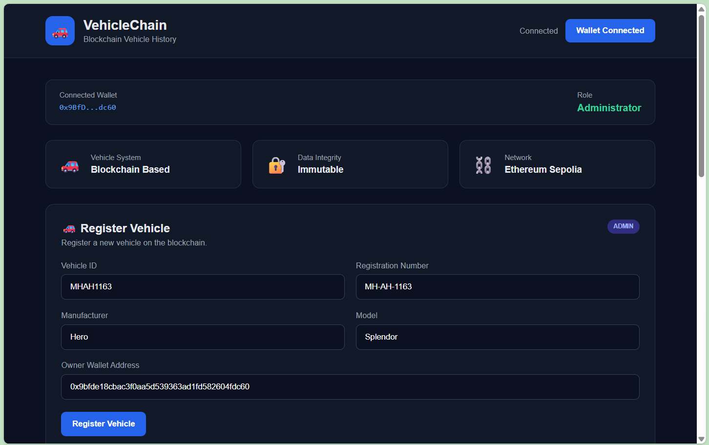
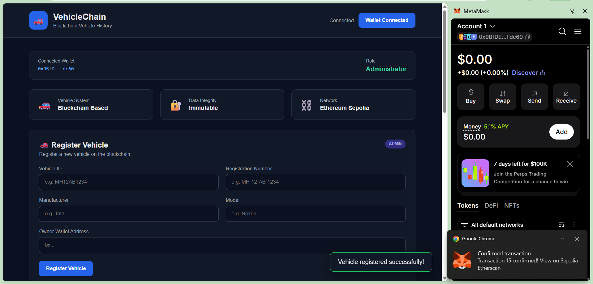
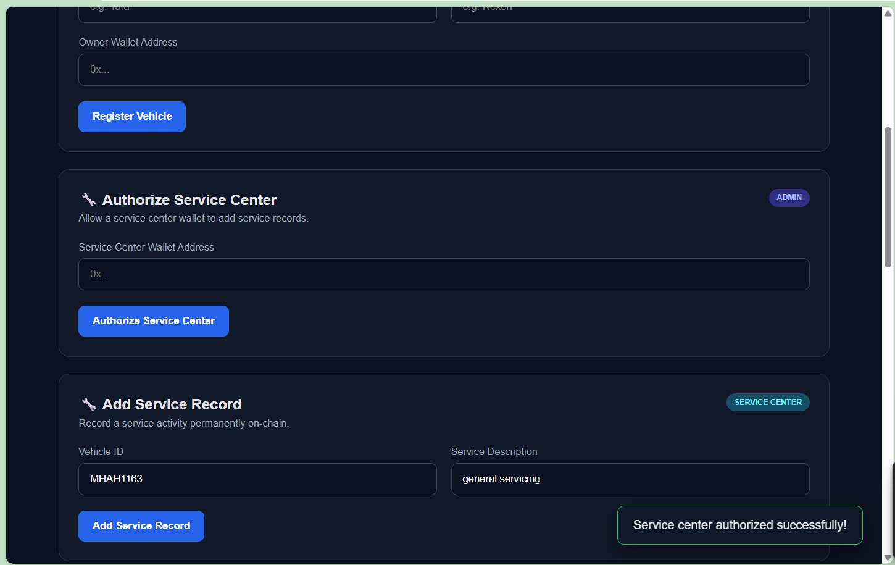
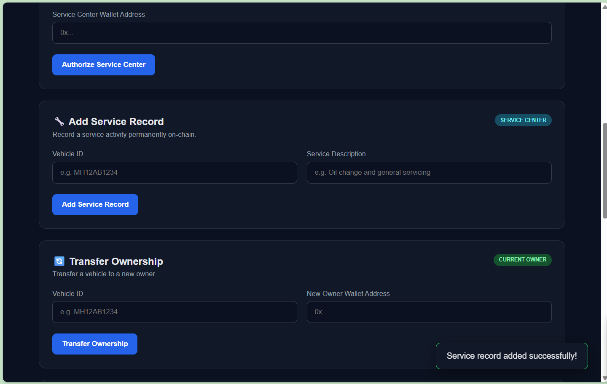
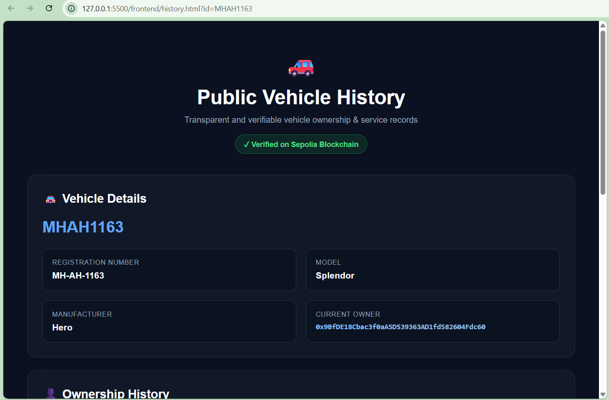
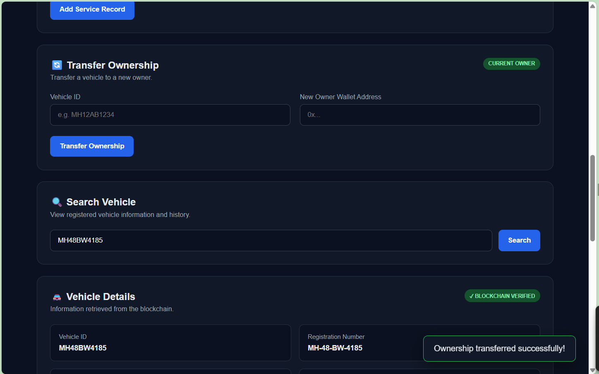
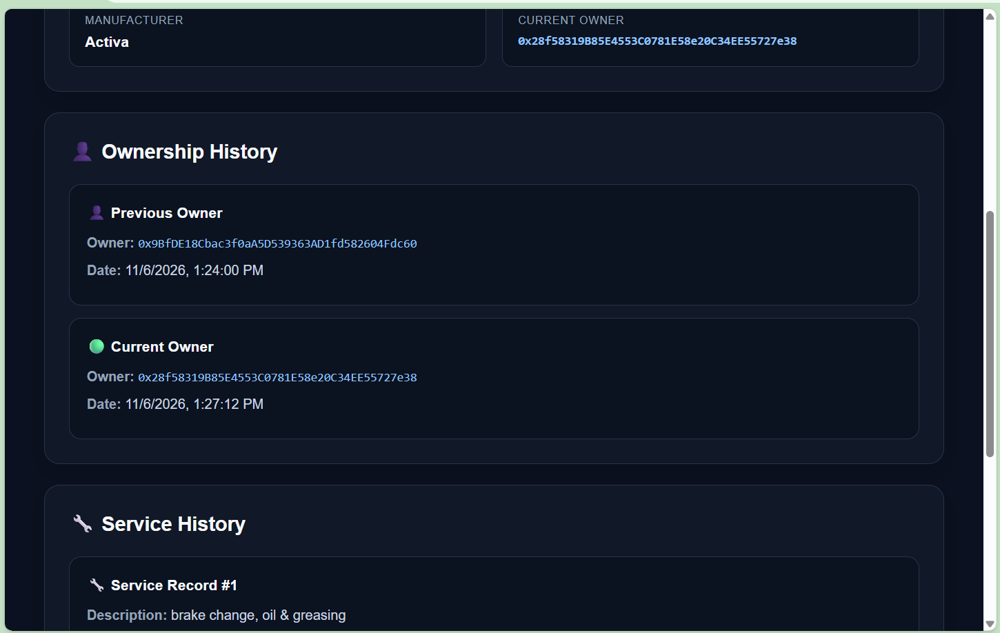

# 🚗 Blockchain Vehicle Ownership & Service History

A blockchain-based decentralized application for maintaining **transparent, verifiable, and tamper-resistant vehicle ownership and service history**.

Built as **PS-12 — Blockchain-Based Vehicle Ownership and Service History** using Solidity, Ethereum Sepolia, MetaMask, Ethers.js, HTML, CSS and JavaScript.

---

## 📌 Problem Statement

When purchasing a used vehicle, buyers may not have access to reliable information about previous ownership, servicing and maintenance.

Traditional records can be incomplete, difficult to verify, or controlled by different parties.

This project uses blockchain technology to create a transparent vehicle history system where:

- Vehicle details are registered on-chain.
- Ownership transfers are recorded permanently.
- Authorized service centers can add service records.
- Users can retrieve complete vehicle history.
- Unauthorized users cannot modify protected records.

---

## 💡 Proposed Solution

The **Vehicle History DApp** provides a blockchain-backed platform with four main roles:

```text
                    VEHICLE HISTORY DApp
                           │
            ┌──────────────┼──────────────┐
            │              │              │
          ADMIN        OWNER        SERVICE CENTER
            │              │              │
     Register Vehicle   Transfer      Add Service
     Authorize Center   Ownership       Record
            │              │              │
            └──────────────┼──────────────┘
                           │
                           ▼
                  VEHICLE HISTORY
                           │
              ┌────────────┴────────────┐
              │                         │
        Ownership History          Service History
              │                         │
              └────────────┬────────────┘
                           ▼
                  Public Verification
```

---

## ✨ Features

### 🚗 Vehicle Registration
- Unique vehicle ID
- Registration number
- Manufacturer
- Model
- Current owner

### 🔧 Service Management
- Authorize service-center wallets
- Add service records
- Record service timestamp
- Store service description
- Store service-center wallet address

### 👤 Ownership Management
- Transfer ownership
- Record previous owners
- Preserve ownership timestamps
- Verify current owner

### 🔍 Vehicle Verification
- Search vehicle by Vehicle ID
- View complete vehicle details
- View ownership history
- View service history

### 🌐 Public Vehicle History
A vehicle-specific public history page can display blockchain-recorded information without requiring the viewer to submit a transaction.

### 📱 QR Verification
The system is designed to support a QR code that opens a vehicle's public history page directly.

---

## 🛠️ Tech Stack

| Technology | Purpose |
|---|---|
| Solidity | Smart contract development |
| Remix IDE | Compilation, deployment and testing |
| Ethereum Sepolia | Blockchain test network |
| MetaMask | Wallet connection and transaction signing |
| Ethers.js v6 | Frontend ↔ smart contract interaction |
| HTML | Frontend structure |
| CSS | Frontend styling |
| JavaScript | DApp functionality |
| VS Code | Development environment |

---

## ⛓️ Smart Contract

### Contract

```text
VehicleHistory.sol
```

### Deployed Contract — Sepolia

```text
0xaA6199115FC58Dec5661373Fb779a3b4650Cb8aa
```

### Main Functions

| Function | Purpose |
|---|---|
| `registerVehicle()` | Register a new vehicle |
| `authorizeServiceCenter()` | Authorize a service-center wallet |
| `addServiceRecord()` | Add a service record |
| `transferOwnership()` | Transfer vehicle ownership |
| `getVehicleDetails()` | Retrieve vehicle information |
| `getServiceHistory()` | Retrieve service history |
| `getOwnershipHistory()` | Retrieve ownership history |
| `vehicleExistsCheck()` | Check whether a vehicle exists |

---

## 🔐 Access Control

The smart contract uses role-based restrictions.

### Admin
Can:

- Register vehicles
- Authorize service centers

### Authorized Service Center
Can:

- Add service records

### Current Vehicle Owner
Can:

- Transfer ownership

### Public User
Can:

- Search vehicles
- View vehicle details
- View ownership history
- View service history

Unauthorized operations are rejected by the smart contract.

---

## 🧪 Demonstration

The project was tested using the following demo vehicle:

```text
Vehicle ID:         MH12AB1234
Registration No:    MH-12-AB-1234
Manufacturer:       Tata
Model:               Nexon
```

Example service record:

```text
Oil change and general vehicle servicing
```

### Tested Workflow

```text
1. Connect Wallet
       ↓
2. Register Vehicle
       ↓
3. Authorize Service Center
       ↓
4. Add Service Record
       ↓
5. Search Vehicle
       ↓
6. Transfer Ownership
       ↓
7. Verify Ownership History
       ↓
8. Verify Service History
       ↓
9. Open Public Vehicle History
```

---

## ✅ Testing & Validation

The following tests were successfully performed:

| Test | Result |
|---|---|
| Wallet connection | ✅ Successful |
| Vehicle registration | ✅ Successful |
| Vehicle search | ✅ Successful |
| Service-center authorization | ✅ Successful |
| Service record addition | ✅ Successful |
| Service history retrieval | ✅ Successful |
| Ownership transfer | ✅ Successful |
| Ownership history retrieval | ✅ Successful |
| Unauthorized service-record attempt | ✅ Correctly rejected |
| Non-owner ownership transfer | ✅ Correctly rejected |
| Public vehicle history | ✅ Implemented |

---

## 🖥️ Application Structure

```text
Vehicle_History_DApp/
│
├── Contracts/
│   └── VehicleHistory.sol
│
├── frontend/
│   ├── index.html
│   ├── history.html
│   ├── script.js
│   └── style.css
│
├── screenshots/
│   ├── 01-wallet-connected.png
│   ├── 02-register-vehicle.png
│   ├── 03-vehicle-registered.png
│   ├── ...
│   └── 17-ownership-transfer-verification.png
│
├── .gitignore
└── README.md
```

---

## 📸 Screenshots

### Wallet Connection


### Vehicle Registration


### Service Center Authorization


### Service Record


### Public Vehicle History


### Ownership Transfer


### Ownership Verification


---

## 🚀 How to Run

### 1. Clone the Repository

```bash
git clone https://github.com/Sahas-2417/blockchain-vehicle-history.git
```

### 2. Open the Project

```bash
cd blockchain-vehicle-history
```

### 3. Open the Frontend

Open:

```text
frontend/index.html
```

using VS Code Live Server or another local web server.

### 4. Connect MetaMask

Use MetaMask with:

```text
Ethereum Sepolia Testnet
```

### 5. Interact with the DApp

Connect the wallet and use the available vehicle registration, service, ownership and verification functions.

---

## 🔄 Application Architecture

```text
                 ┌─────────────────────┐
                 │      User           │
                 └──────────┬──────────┘
                            │
                            ▼
                 ┌─────────────────────┐
                 │  HTML / CSS / JS    │
                 │     Frontend        │
                 └──────────┬──────────┘
                            │
                            ▼
                 ┌─────────────────────┐
                 │     Ethers.js       │
                 └──────────┬──────────┘
                            │
                            ▼
                 ┌─────────────────────┐
                 │      MetaMask       │
                 └──────────┬──────────┘
                            │
                            ▼
                 ┌─────────────────────┐
                 │ VehicleHistory.sol  │
                 │   Smart Contract    │
                 └──────────┬──────────┘
                            │
                            ▼
                 ┌─────────────────────┐
                 │ Ethereum Sepolia    │
                 │    Test Network     │
                 └─────────────────────┘
```

---

## 🔒 Security & Limitations

- Only the administrator can authorize service centers.
- Only authorized service centers can add service records.
- Only the current owner can transfer ownership.
- Ordinary users cannot delete historical records through the contract.
- Wallet addresses represent blockchain identities but do not independently verify real-world identity.
- This project is an academic/testnet implementation and is not a replacement for official vehicle-registration authorities.

---

## 🔮 Future Enhancements

- QR-code based vehicle verification
- Richer service data such as mileage, cost and replaced parts
- Service-center names and verification
- Vehicle registration-number search
- Improved role-based dashboards
- Document/invoice hash verification
- Stronger real-world identity verification
- Security audit before production deployment
- Production blockchain deployment

---

## 🎓 Project Information

**Problem Statement:** PS-12  
**Project:** Blockchain-Based Vehicle Ownership and Service History  
**Domain:** Blockchain / Decentralized Applications

---

## 👨‍💻 Author

**Sahas Bochare**

GitHub:  
https://github.com/Sahas-2417

---

⭐ If you find this project useful, consider starring the repository.